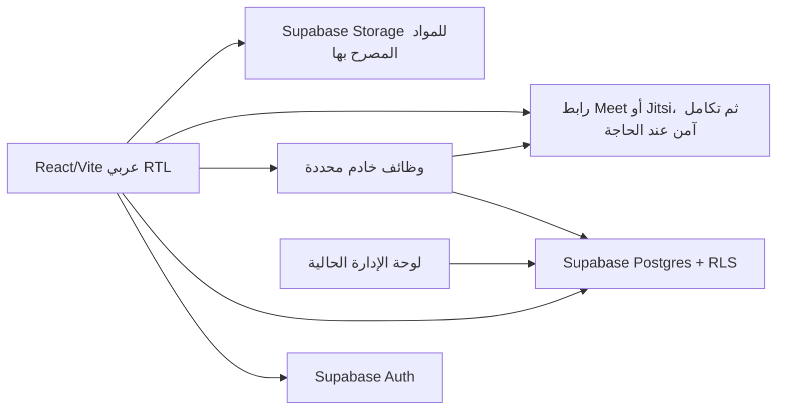
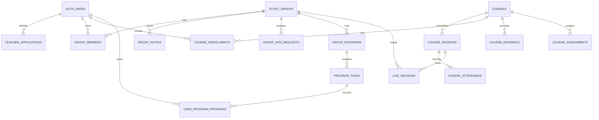

# التصميم الهندسي المبدئي

هذا تصميم للتنفيذ التدريجي، وليس وصفًا لخدمات شُغلت. لا يغير مصدر بيانات التخطيط الحالي قبل مهمة تحويل مستقلة.

## البنية

تبقى إدارة الدورات والحلقات والاستحقاق في Postgres. تفضيل صاحب المشروع في 2026-10-30 هو بدء الفيديو عبر Google Meet أو Jitsi، والصوت بإغلاق الكاميرات في الخدمة نفسها. يُعرض رابط الاجتماع للمصرح لهم فقط، لكن ذلك لا يسحب صلاحية دخول من احتفظ بالرابط خارج التطبيق. القاعات التي تتطلب ضمان تحقق العضوية داخل خدمة البث تحتاج إعدادات دخول مناسبة للمزود أو تكاملًا آمنًا مستقلًا؛ لا يجوز وصف الرابط الخارجي وحده بأنه دخول محمي. يُمنع وضع أسرار التكامل أو إدارة الدفع في حزمة Vite. لا microservices إضافية. الاستضافة الحالية للواجهة على Netlify أو Cloudflare بحسب البيئة المختارة؛ الوظائف الآمنة قرب Supabase أو خدمة خادم مكافئة.

واجهة الشيخ المعتمد امتداد للواجهة الشخصية نفسها، مع مسارات إدارة دوراته ودروسه وطلابه ومجموعاته. لا يُستمد اعتماد الشيخ من صلاحية إدارة المنصة، ولا يمنح إنشاء مجموعة تواصٍ صلاحية نشرها علنًا؛ تستخدم مجموعات الشيخ سياسات الدعوة والعضوية الخاصة نفسها. واجهة المستخدم العادي تعرض التواصي الخاص ودوراته المسجل فيها دون أدوات إنشاء المحتوى العام. تُحجز الدراسة والواجبات والاختبارات لمجالس العلم، بينما تقتصر مجالس التواصي على الذكر والتأمل ومحاور الاجتماع. يتحقق الخادم من الدور لكل عملية، ولا يعتمد على إخفاء عناصر التنقل.

## نموذج البيانات المقترح

معرفات UUID. `study_groups` خاصة بقيود قاعدة البيانات، ولا عمود `public=true`. الدعوات تحفظ بصمة الرمز لا الرمز الخام، مع انتهاء وعدد مرات وحدود طلبات. العضوية والأدوار في صف واحد بقيود تمنع ترقية النفس. مهام البرنامج بإصدارات أو أحداث تقدم تحفظ التاريخ عند تغيير النص. `courses` تفصل المسودة عن النشر، ونوع الوصول مجاني/مدفوع لا يمنح وصولًا وحده. `course_sessions` تحفظ لحظة UTC والمنطقة IANA وقاعدة تكرار واضحة. `live_sessions` تحفظ الحالة والحضور دون وسائط أو رابط تسجيل. الاستحقاقات المالية، عند اعتمادها، في جداول منفصلة عن التسجيل الدراسي. `auth.users` هو مصدر الحسابات؛ لا جدول كلمات مرور.

## عمليات الخادم والعقد

| العملية | تحقق الخادم والنتيجة |
|---|---|
| إنشاء حلقة | مصادقة؛ إنشاء حلقة وعضوية مؤسس في معاملة واحدة |
| إنشاء/تجديد دعوة | مؤسس أو مفوض؛ رمز عشوائي يُعاد مرة واحدة وتُحفظ بصمته |
| طلب انضمام | دعوة صالحة؛ طلب مع منع التكرار، بلا عضوية تلقائية |
| البت في الطلب | دور مخول وسعة؛ عضوية أو رفض ذري وسجل قرار |
| إزالة/نقل عضو | تحقق دور وقواعد آخر مؤسس؛ إبطال وصول الجلسات التالية |
| إنشاء/نشر دورة | اعتماد المعلم وحالة الدورة ومراجعة الإدارة عند السياسة |
| تسجيل دورة | صلاحية مجانية أو استحقاق مدفوع، وسعة ذرية |
| إصدار تذكرة قاعة | جلسة قائمة وعضوية/تسجيل صالح؛ صلاحية قصيرة ودور مضبوط |
| تقدم البرنامج | المالك فقط؛ مشاركة إجمالية اختيارية ومحددة |

تُعرض البيانات عبر استعلامات Supabase المحمية بـRLS حيث تكفي، وتستخدم وظائف خادم للمعاملات الحساسة والرموز والقرارات المالية/البث. لا يكفي إخفاء زر في الواجهة. العمليات الحساسة لها تحقق مدخلات، rate limiting، سجل تدقيق، ومعرف طلب لتجنب التكرار.

## مصفوفة وصول مختصرة

| المورد | زائر | صاحب الحساب | عضو الحلقة | مسؤول الحلقة | معلم معتمد | إدارة |
|---|---|---|---|---|---|---|
| حلقة خاصة | لا | حلقاته فقط | قراءة المسموح | إدارة مفوضة | حسب عضويته | بلاغات وفق السياسة |
| طلب/دعوة | لا | طلب عبر رمز | حسب دوره | قبول/رفض حسب الدور | حسب عضويته | تدقيق محدد |
| تقدم فردي | لا | تقدمه فقط | لا إلا بموافقة مشاركة | إجمالي محدود | لا | لا وصول عام |
| دورة منشورة عامة | قراءة | قراءة | قراءة | قراءة | إدارة دوراته | مراجعة |
| دورة غير منشورة | لا | لا | لا | لا | صاحبها | مراجعة |
| قاعة مباشرة | لا | عند الاستحقاق | عند عضوية الحلقة | إدارة حلقة | إدارة مجلسه | دخول فقط بسياسة معلنة |
| المحاسبة الشخصية | لا | المالك فقط | لا | لا | لا | لا |

RLS هي الحاجز الأساسي للبيانات؛ وظائف الخادم تعيد فحص الهوية والصلاحية. لا تفترض أن الإدارة تقرأ تفاصيل حلقات خاصة. قرار التعامل مع البلاغات يحتاج سياسة وصول محدودة.

## البث والمناطق الزمنية والتكلفة

**قرار نطاق أحدث (2026-10-30):** كشف رابط جلسة التواصي يتطلب عضوية الحلقة واستحقاق Premium مدفوعًا ساريًا أو منح ميزة `circle_live` من أدمن المنصة. لا يكتب العميل سجل الدفع؛ مصدره المستقبلي تكامل خادمي يتحقق من مزود دفع لم يُحدد بعد. يستطيع الأدمن منح أو سحب مميزات أعضاء منفصلة عن سجل الاشتراك. سحب الكشف داخل التطبيق لا يلغي رابط Meet الذي سبق نسخه؛ قبول الدخول إلى القاعة يبقى عند مضيف Meet.

يسجل الخادم حدث الاشتراك بمعرّف فريد من المزود وتوقيته بعد التحقق من توقيع webhook؛ تكرار الحدث لا يكرر الأثر، والحدث الأقدم لا يعيد تفعيل اشتراك أُلغي أو استُرد. هذا السجل لا ينفذ التحقق من التوقيع بنفسه؛ تكامل المزود مسؤول عنه عند اختياره.

النطاق المجاني المعتمد في 2026-10-30 يبدأ برابط Google Meet خارجي للمجالس والحلقات، مع وضع صوت فقط أو إيقاف الكاميرات عند ضعف الاتصال. حساب Google الشخصي محدود إلى 100 مشارك و60 دقيقة للاجتماع الجماعي وفق توثيق Google؛ يُختبر ذلك على حساب المنظم الفعلي. مشرف المنصة أو مسؤول الحلقة داخل الربانيون لا يصبح مضيف Meet تلقائيًا؛ المضيف ينشئ اللقاء ويتحكم في القبول والصوت والفيديو، ويمكن تفويض مساعد وفق إمكانيات الحساب. Jitsi العام خيار تجريبي للصوت، لكنه ليس مخصصًا لتكامل تطبيق إنتاجي وفق وثائق المشروع. لا يُشترى بث أو استضافة خاصة ضمن النطاق الحالي. إذا لم تُحقق الأدوات المجانية شرط الخصوصية أو السعة، تُوثق الفجوة ويُراجع القرار مع صاحب المشروع. لا تسجيل ولا تخزين وسائط من التطبيق؛ يُراجع ضبط التسجيل لدى المزود، مع بيان أن المنصة لا تستطيع منع التسجيل الخارجي أو التحكم في كل إعدادات اجتماع خارجي.

المواعيد تحفظ UTC، مع منطقة IANA لكل جدول دوري. يُحسب اللقاء الدوري في منطق يفهم التوقيت الصيفي ثم يُعرض محليًا للطالب والمعلم. اختبارات لعبور DST واجبة قبل الاعتماد. الإشعارات تُرسل وفق التفضيل والمنطقة الزمنية، ولا يُستخدم polling مستمر.

## النشر والتحقق

أضف الترحيلات كملفات جديدة فقط؛ افحص سجل `private.schema_migrations` في البيئة الهدف ونسخة احتياطية قبل التطبيق. اختبر RLS بحسابات مختلفة، ومزامنة JSON القائمة، ثم اختبارات واجهة وهاتف وبث. تُضبط أسرار البث والدفع في الخادم فقط، وتُراقب أخطاء الدخول وتكلفة دقائق البث. الإطلاق محدود أولًا مع خطة رجوع. المدفوعات الحقيقية والشراء والنشر الإنتاجي قرارات منفصلة.
